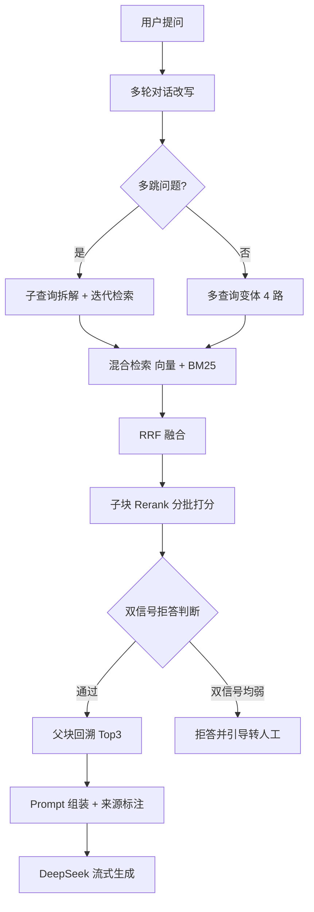

# 企业智能服务台（模块化 RAG 问答系统）

基于 Streamlit + DeepSeek 的混合检索 RAG 问答系统，实现"父子分块 → 向量 + BM25 混合检索 → RRF 融合 → Rerank 重排 → 父块回溯 → 多跳分解 → 双信号拒答 → 流式生成"完整检索问答管线，支持多轮对话改写、多查询变体、增量入库。

## 效果指标（消融评测）

自建 60 题开发集 + 240 题独立测试集，完成 5 组消融实验：

| 指标 | 单路检索（基线） | 混合检索（当前） |
|---|---|---|
| 开发集全链路通过率 | 95.0%（57/60） | 98.3%（59/60） |
| 其中复杂组合题通过率 | 90.5%（19/21） | 100%（21/21） |

- 独立测试集（240 题，与开发集隔离）全链路通过率：**87.9%（211/240）**
- 拒答类准确率：**100%（40/40）**

> 口径：通过率 = 全链路（改写 → 检索 → 重排 → 生成）回答正确占比。

## 功能特性

- **混合检索**：向量 + BM25 双路召回，RRF 融合（key 为元组，防内容碰撞导致 metadata 覆盖）
- **父子分块**：子块（250 字）做检索、父块（1200 字）做上下文；Rerank 分批计算防 OOM，父块回溯保序取回
- **双信号拒答防幻觉**：Rerank 分数 < 0.2 时，用向量余弦距离（≤ 0.6）做第二信号复核；双信号均弱才拒答，避免 FAQ 类文本被 Rerank 系统性低分误杀（实测拒答类 100% 准确）
- **多轮对话改写** + **多查询变体**（原问题 + 3 变体共 4 路检索）+ **多跳问题自动拆解**（迭代检索，上一步结果作为下一步线索）
- 流式输出、对话历史持久化、增量入库（md5 内容去重）、快捷提问按钮

## 架构流程



## 目录结构

| 文件 | 职责 |
|---|---|
| `app.py` | 应用入口：页面配置、会话状态、持久化知识库加载、侧边栏、快捷提问、提问入口 |
| `config.py` | 全局配置：HF 镜像端点、路径、Rerank 阈值、双信号距离阈值、父子分块参数 |
| `llm.py` | 公共 LLM 客户端（DeepSeek） |
| `query_analysis.py` | 多轮对话改写 / 多跳分解 / 查询变体生成 |
| `document_loader.py` | 文件解析（pdf/docx/txt）+ 对话历史保存 |
| `ingest.py` | 上传入库：父子分块 → 向量化 → 增量入库 → 重建 BM25 |
| `qa_flow.py` | 提问主流程：改写 → 多跳/变体 → 混合检索 → RRF 融合 → 子块重排 → 父块回溯 → 拒答判断 → 流式生成 |

## 运行方式

```bash
pip install -r requirements.txt
```

复制 `env.example` 为 `.env` 并填入真实 API Key：

```bash
cp env.example .env   # Windows: copy env.example .env
```

启动：

```bash
streamlit run app.py
```

> 运行时会在项目根目录生成 `chroma_db/`（向量库）与 `chat_history.json`（对话历史），两者已由 `.gitignore` 忽略，不会提交到仓库。
